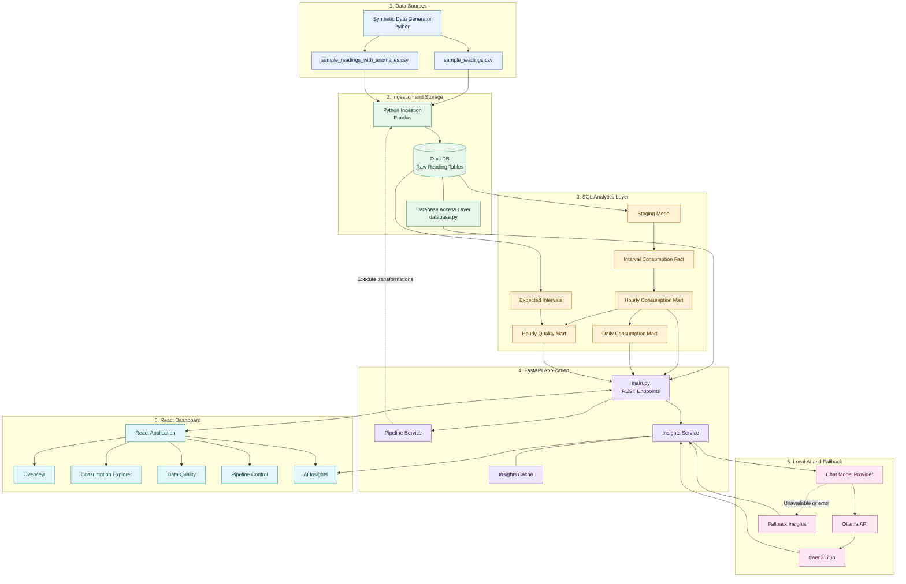
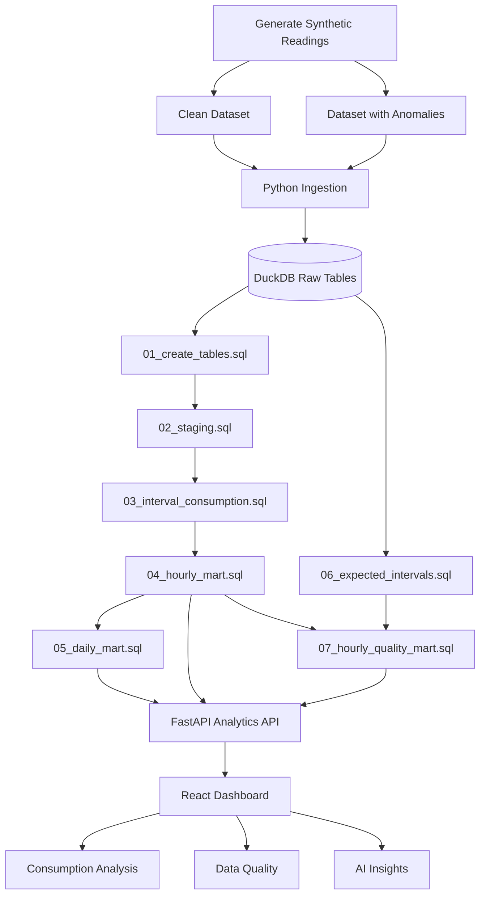
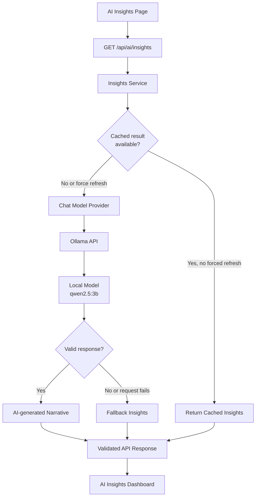

# Energy Consumption Mart

An end-to-end analytics engineering project that transforms raw smart-meter readings into reusable hourly and daily consumption marts, validates data quality, analyzes consumption patterns, and generates AI-assisted analytical insights.

Built using **Python, SQL, DuckDB, FastAPI, React, Vite, Tailwind CSS, and Recharts**, with a local Ollama model for AI-generated narratives.

> **Dataset notice:** All included smart-meter datasets are synthetic and intended for demonstration, testing, and analytics engineering evaluation. They do not represent actual customer electricity consumption.

---

## Table of Contents

1. [Problem Statement](#1-problem-statement)
2. [Project Approach](#2-project-approach)
3. [Key Features](#3-key-features)
4. [Technology Stack](#4-technology-stack)
5. [System Architecture](#5-system-architecture)
6. [Data Pipeline and Data Flow](#6-data-pipeline-and-data-flow)
7. [Project Structure](#7-project-structure)
8. [Data Model and Schema](#8-data-model-and-schema)
9. [Frontend Pages](#9-frontend-pages)
10. [Backend API](#10-backend-api)
11. [AI Approach](#11-ai-approach)
12. [Installation and Setup](#12-installation-and-setup)
13. [How to Run the Solution](#13-how-to-run-the-solution)
14. [SQL Transformation Models](#14-sql-transformation-models)
15. [Tests Performed](#15-tests-performed)
16. [Sample Results](#16-sample-results)
17. [Assumptions](#17-assumptions)
18. [Known Limitations](#18-known-limitations)
19. [Production Improvements](#19-production-improvements)
20. [Demo Walkthrough](#20-demo-walkthrough)

---

## 1. Problem Statement

Electricity consumption analytics depends on accurate, complete, and well-structured smart-meter data. However, smart meters commonly record cumulative energy readings at regular intervals rather than directly providing all the consumption metrics required for reporting and analysis.

Raw meter data may contain duplicate readings, missing intervals, null or invalid values, and meter-counter resets. These issues can distort consumption calculations, reduce data completeness, and produce misleading analytical results.

Without a reliable data transformation and quality-validation process, it becomes difficult to calculate hourly and daily electricity consumption, identify consumption patterns, measure data completeness, and provide trustworthy insights.

### Project objective

The objective of **Energy Consumption Mart** is to design and implement a reproducible analytics engineering pipeline that transforms raw cumulative smart-meter readings into reliable, reusable analytical models.

The solution must:

- Convert cumulative readings into interval-level consumption.
- Aggregate consumption into hourly and daily analytical marts.
- Identify invalid readings and potential data-quality issues.
- Compare expected intervals with valid observations to measure completeness.
- Expose analytical metrics through a backend API.
- Present consumption and quality metrics through an interactive dashboard.
- Generate AI-assisted explanations of analytical results, with fallback behavior when AI generation fails.

### Expected outcome

The project delivers an end-to-end analytics solution consisting of synthetic data generation, Python-based ingestion, SQL transformations, DuckDB storage, data-quality validation, a FastAPI backend, a React dashboard, and local AI-assisted insights.

---

## 2. Project Approach

The solution follows a layered analytics engineering approach.

1. **Generate data:** Create synthetic cumulative smart-meter readings at regular 15-minute intervals.
2. **Ingest data:** Load clean and anomalous CSV datasets into DuckDB using Python and Pandas.
3. **Transform data:** Use SQL models to prepare readings and calculate interval consumption.
4. **Build analytical marts:** Aggregate interval consumption into hourly and daily models.
5. **Validate quality:** Generate expected intervals and compare them with observed valid data.
6. **Expose analytics:** Provide REST endpoints through FastAPI.
7. **Visualize results:** Use React and Recharts to display consumption trends, quality metrics, and pipeline status.
8. **Generate insights:** Use a local Ollama model to produce explanatory narratives, with fallback handling for failures.
9. **Test reliability:** Validate API behavior, pipeline execution, failure handling, and analytical mart integrity.

This separation keeps ingestion, transformations, quality checks, backend services, and presentation logic independently understandable and testable.

---

## 3. Key Features

### Data engineering

- Reproducible synthetic smart-meter data generation.
- Python-based CSV ingestion using Pandas and DuckDB.
- SQL-based staging and transformation pipeline.
- Hourly and daily consumption marts.
- Expected-interval generation.
- Automated analytical mart verification.

### Analytics and data quality

- Total consumption and meter-level summaries.
- Hourly and daily consumption trends.
- Interval-status classification.
- Missing and invalid reading analysis.
- Completeness calculations.
- Duplicate-key validation.
- Identification of incomplete meter-hour records.

### Dashboard and operations

- Overview dashboard.
- Consumption Explorer.
- Data Quality dashboard.
- Pipeline Control page.
- AI Insights page.
- REST API access to analytical data.
- Pipeline status and execution handling.

### AI-assisted analytics

- Local Ollama model integration.
- Configurable model and request timeout.
- AI-generated analytical narratives.
- Insights caching and refresh support.
- Fallback behavior when AI generation fails.

---

## 4. Technology Stack

| Layer | Technology | Purpose |
|---|---|---|
| Programming language | Python | Data generation, ingestion, backend logic, and verification |
| Data manipulation | Pandas, NumPy | Data preparation and synthetic data generation |
| Analytical database | DuckDB | Local analytical storage and SQL execution |
| Transformation | SQL | Staging, interval calculation, marts, and quality models |
| Backend framework | FastAPI | REST API and application services |
| ASGI server | Uvicorn | Runs the FastAPI application |
| AI runtime | Ollama | Runs the local language model |
| AI integration | HTTPX, LangChain Core message types | Model communication and message handling |
| Frontend framework | React | Dashboard interface |
| Frontend tooling | Vite | Development server and production build |
| Styling | Tailwind CSS, CSS | Layout, styling, and responsiveness |
| Data visualization | Recharts | Consumption and analytics charts |
| HTTP client | Axios | Frontend-to-backend communication |
| Testing | Pytest | API, pipeline, and AI behavior tests |
| Version control | Git | Source control and collaboration |

---

## 5. System Architecture

The architecture separates the data-processing pipeline from the application layer while keeping both connected through DuckDB and FastAPI.

The diagram below shows the main system components, the two analytical processing branches, the dashboard pages, and the AI fallback path.



### Architecture responsibilities

| Component | Responsibility |
|---|---|
| Data generator | Creates reproducible synthetic meter-reading datasets |
| Ingestion module | Loads source data into DuckDB |
| DuckDB | Stores raw readings and transformed analytical data |
| SQL models | Calculate consumption, aggregates, expected intervals, and quality metrics |
| Database module | Provides database access to application services |
| Pipeline service | Coordinates pipeline execution and reports pipeline status |
| FastAPI | Exposes analytical data and operational endpoints |
| Insights service | Generates, caches, and returns analytical insights |
| Ollama provider | Communicates with the locally running language model |
| React frontend | Displays metrics, charts, quality information, and insights |

---

## 6. Data Pipeline and Data Flow

The analytical pipeline transforms cumulative meter readings into consumption metrics while independently evaluating whether the resulting data is complete.



### Pipeline stages

**1. Data generation**

The generator creates synthetic cumulative meter readings at 15-minute intervals for the configured sample period.

**2. Data ingestion**

Python and Pandas load the clean and anomalous CSV datasets into DuckDB.

**3. Staging**

The staging model prepares raw readings for downstream calculations.

**4. Interval consumption**

Consumption is calculated from successive cumulative readings. Invalid intervals and potential meter resets are classified rather than blindly treated as normal consumption.

**5. Hourly aggregation**

Valid interval consumption is aggregated into hourly records.

**6. Daily aggregation**

Hourly consumption is aggregated into daily records for higher-level analysis.

**7. Expected intervals**

The pipeline establishes which reading intervals should exist for completeness assessment.

**8. Quality assessment**

Expected intervals and hourly quality information are used to identify missing or incomplete data and calculate completeness metrics.

**9. API delivery**

FastAPI exposes the resulting analytical data to the frontend.

**10. Dashboard and AI insights**

The React dashboard displays consumption and quality metrics. The AI Insights page provides explanatory narratives through the local Ollama model and fallback behavior.

---

## 7. Project Structure

The following tree documents the source files visible in the project. Generated artifacts, virtual environments, caches, and dependency directories are omitted from the main tree because they are machine-specific or reproducible.

```text
energy-consumption-mart/
│
├── backend/
│   ├── app/
│   │   ├── ai/
│   │   │   ├── chat_model_provider.py
│   │   │   └── schemas.py
│   │   │
│   │   ├── data/
│   │   │   ├── __init__.py
│   │   │   ├── database.py
│   │   │   └── ingest.py
│   │   │
│   │   ├── services/
│   │   │   ├── insights_service.py
│   │   │   └── pipeline_service.py
│   │   │
│   │   └── main.py
│   │
│   ├── sql/
│   │   ├── 01_create_tables.sql
│   │   ├── 02_staging.sql
│   │   ├── 03_interval_consumption.sql
│   │   ├── 04_hourly_mart.sql
│   │   ├── 05_daily_mart.sql
│   │   ├── 06_expected_intervals.sql
│   │   └── 07_hourly_quality_mart.sql
│   │
│   ├── tests/
│   │   ├── test_ai_insights.py
│   │   ├── test_api.py
│   │   └── test_pipeline.py
│   │
│   ├── requirements.txt
│   └── verify_marts.py
│
├── data/
│   ├── generate_data.py
│   ├── sample_readings.csv
│   └── sample_readings_with_anomalies.csv
│
├── frontend/
│   ├── public/
│   ├── src/
│   │   ├── assets/
│   │   ├── components/
│   │   │   ├── ConsumptionChart.jsx
│   │   │   └── Layout.jsx
│   │   │
│   │   ├── pages/
│   │   │   ├── AIInsights.jsx
│   │   │   ├── ConsumptionExplorer.jsx
│   │   │   ├── DataQuality.jsx
│   │   │   ├── Overview.jsx
│   │   │   └── PipelineControl.jsx
│   │   │
│   │   ├── services/
│   │   │   ├── api.js
│   │   │   └── pipelineApi.js
│   │   │
│   │   ├── App.css
│   │   ├── App.jsx
│   │   ├── index.css
│   │   └── main.jsx
│   │
│   ├── .gitignore
│   ├── eslint.config.js
│   ├── index.html
│   └── package-lock.json
│
├── .env.example
├── .gitignore
├── DESIGN.md
└── README.md
```

The local development environment also contains generated artifacts such as `backend/energy_mart.duckdb`, `backend/.venv/`, `frontend/node_modules/`, `frontend/dist/`, and test caches. These should generally remain untracked.

### Backend modules

| File | Responsibility |
|---|---|
| `app/main.py` | FastAPI application, CORS configuration, and REST endpoints |
| `app/data/database.py` | DuckDB database access and query execution |
| `app/data/ingest.py` | Source data ingestion |
| `app/services/pipeline_service.py` | Pipeline execution, status, and coordination |
| `app/services/insights_service.py` | AI insight generation, caching, and fallback behavior |
| `app/ai/chat_model_provider.py` | Local Ollama model communication |
| `app/ai/schemas.py` | AI-related response schemas |
| `verify_marts.py` | Analytical mart and data-quality verification |

### Frontend modules

| File | Responsibility |
|---|---|
| `src/App.jsx` | Main React application and page composition |
| `src/main.jsx` | React entry point |
| `src/components/Layout.jsx` | Shared layout and navigation |
| `src/components/ConsumptionChart.jsx` | Reusable consumption chart |
| `src/pages/Overview.jsx` | Summary dashboard |
| `src/pages/ConsumptionExplorer.jsx` | Detailed consumption exploration |
| `src/pages/DataQuality.jsx` | Data-quality metrics and anomaly analysis |
| `src/pages/PipelineControl.jsx` | Pipeline status and execution controls |
| `src/pages/AIInsights.jsx` | AI-assisted analytical insights |
| `src/services/api.js` | General API communication |
| `src/services/pipelineApi.js` | Pipeline API communication |
| `src/App.css` | Application-level styles |
| `src/index.css` | Global styles |

---

## 8. Data Model and Schema

The data model separates raw readings, interval-level consumption, aggregate marts, and data-quality information.

### Raw readings

The source data contains cumulative smart-meter readings recorded at regular intervals.

The documented generator configuration uses:

| Parameter | Value |
|---|---:|
| Meters | 10 |
| Sites | 5 |
| Duration | 30 days |
| Reading interval | 15 minutes |

These are the intended sample-generation settings. Actual row counts depend on the generated data and any anomaly-injection logic.

### Interval consumption

For a cumulative meter, interval consumption is calculated using consecutive readings:

\[
C_t = R_t - R_{t-1}
\]

Where:

- \(C_t\) is consumption during the interval.
- \(R_t\) is the current cumulative reading.
- \(R_{t-1}\) is the previous cumulative reading.

Negative differences may indicate a meter reset, invalid data, or another condition that needs investigation. Such differences should not automatically be treated as valid electricity consumption.

### Analytical models

| Model | Grain or purpose | Main use |
|---|---|---|
| Raw reading tables | Source meter readings | Preserve ingested input data |
| Staging model | Prepared source readings | Standardize data for transformations |
| `fct_interval_consumption` | Meter-reading intervals | Calculate and classify interval consumption |
| `hourly_mart` | Hourly consumption aggregates | Analyze hourly trends |
| `daily_mart` | Daily consumption aggregates | Analyze daily trends |
| Expected intervals model | Expected reading intervals | Assess completeness |
| `hourly_quality_mart` | Meter-hour quality records | Combine consumption and quality metrics |

The physical table and column definitions are maintained in the SQL files under `backend/sql/`.

### Hourly quality metrics

The hourly quality mart includes metrics such as:

- Total valid consumption in kWh.
- Valid interval count.
- Expected interval count.
- Completeness percentage.

Completeness is calculated as:

\[
\text{Completeness (\%)} =
\frac{\text{Valid intervals}}{\text{Expected intervals}}
\times 100
\]

The SQL uses `NULLIF` where needed to prevent division by zero.

### Daily metrics

The daily endpoint aggregates hourly records by meter, site, and calendar date. Daily consumption is the sum of hourly valid consumption, while daily completeness is calculated from the summed valid and expected interval counts.

---

## 9. Frontend Pages

The frontend is built with React and Vite, with charting provided by Recharts.

### Overview

**File:** `frontend/src/pages/Overview.jsx`

Presents a high-level view of electricity consumption and summary metrics, helping users understand the overall analytical results.

### Consumption Explorer

**File:** `frontend/src/pages/ConsumptionExplorer.jsx`

Supports detailed consumption exploration using hourly and daily analytical data.

**Reusable chart:** `frontend/src/components/ConsumptionChart.jsx`

### Data Quality

**File:** `frontend/src/pages/DataQuality.jsx`

Displays data-quality results, including interval-status counts, completeness metrics, and incomplete-hour records.

### Pipeline Control

**File:** `frontend/src/pages/PipelineControl.jsx`

Provides the interface for checking pipeline status and triggering pipeline execution.

**API service:** `frontend/src/services/pipelineApi.js`

### AI Insights

**File:** `frontend/src/pages/AIInsights.jsx`

Presents AI-assisted explanations of analytical results through the backend insights service.

### Shared application components

- `Layout.jsx` provides the shared dashboard layout.
- `App.jsx` composes the application and its navigation.
- `api.js` handles general backend communication.
- `pipelineApi.js` handles pipeline-related API requests.
- `App.css` and `index.css` provide application and global styling.

---

## 10. Backend API

The backend uses FastAPI and DuckDB to expose analytical data, data-quality results, pipeline operations, and AI insights.

### API metadata

- **Title:** Energy Consumption Mart API
- **Version:** 1.0.0
- **Description:** Analytics API for synthetic smart-meter consumption data.
- **Interactive documentation:** `/docs`
- **OpenAPI schema:** `/openapi.json`

### API endpoint reference

| Method | Endpoint | Purpose |
|---|---|---|
| `GET` | `/` | Returns the API status message |
| `GET` | `/health` | Checks API health and database-file existence |
| `GET` | `/api/overview` | Returns aggregate consumption and quality metrics |
| `GET` | `/api/hourly` | Returns hourly consumption and quality data |
| `GET` | `/api/daily` | Returns daily consumption aggregates |
| `GET` | `/api/quality` | Returns interval-status counts and incomplete hours |
| `GET` | `/api/pipeline/status` | Returns the current pipeline status |
| `POST` | `/api/pipeline/run` | Starts pipeline execution |
| `GET` | `/api/ai/insights` | Returns AI-assisted insights |

### Overview endpoint

`GET /api/overview`

Returns:

- Total valid consumption.
- Valid and expected interval counts.
- Overall completeness percentage.
- Distinct meter and site counts.
- Count of incomplete meter-hour records.

### Hourly endpoint

`GET /api/hourly`

Optional query parameters:

| Parameter | Description |
|---|---|
| `meter_id` | Filter by meter |
| `site_id` | Filter by site |
| `start_date` | Include records at or after this timestamp |
| `end_date` | Include records before midnight following this date |

Example:

```text
/api/hourly
/api/hourly?meter_id=M001
/api/hourly?site_id=S001
/api/hourly?start_date=2026-09-01&end_date=2026-09-07
/api/hourly?meter_id=M001&site_id=S001
```

The endpoint returns meter and site identifiers, hour start, consumption in kWh, valid intervals, expected intervals, and completeness percentage.

**Date-filter behavior:** `end_date` is an exclusive upper boundary at midnight after the supplied date. An `end_date` of `2026-09-07` includes September 7 but excludes September 8.

### Daily endpoint

`GET /api/daily`

Optional query parameters:

- `meter_id`
- `site_id`

Example:

```text
/api/daily
/api/daily?meter_id=M001
/api/daily?site_id=S001
/api/daily?meter_id=M001&site_id=S001
```

The response contains the meter, site, consumption date, daily consumption, valid intervals, expected intervals, and completeness percentage.

### Data quality endpoint

`GET /api/quality`

Optional parameter:

| Parameter | Default | Allowed range |
|---|---:|---|
| `limit` | 100 | 1–1000 |

Example:

```text
/api/quality
/api/quality?limit=20
/api/quality?limit=500
```

The response contains:

- `status_summary`: counts grouped by `interval_status` from `fct_interval_consumption`.
- `incomplete_hours`: incomplete meter-hour records ordered by completeness.

### Pipeline endpoints

`GET /api/pipeline/status`

Returns the pipeline status provided by the pipeline service.

`POST /api/pipeline/run`

Triggers pipeline execution through a thread pool. If another run is already in progress, the endpoint returns HTTP `409 Conflict`. It clears the AI insights cache when the returned status is not `already_running`.

### AI insights endpoint

`GET /api/ai/insights`

Optional parameter:

| Parameter | Default | Purpose |
|---|---|---|
| `force_refresh` | `false` | Requests refreshed insights instead of relying on the cached result |

Example:

```text
/api/ai/insights
/api/ai/insights?force_refresh=true
```

The response is validated using `AIInsightsResponse`. Unexpected insight-generation failures are returned as HTTP `502 Bad Gateway`; existing `HTTPException` errors are re-raised.

### Interactive API documentation

When the backend is running:

- Swagger UI: `http://127.0.0.1:8000/docs`
- OpenAPI schema: `http://127.0.0.1:8000/openapi.json`

### CORS configuration

The current backend allows these frontend development origins:

- `http://localhost:5173`
- `http://127.0.0.1:5173`

For deployment to another origin, update the CORS allowlist accordingly.

---

## 11. AI Approach

The project uses a local Ollama model to generate narrative explanations of analytical results.

### AI architecture



### Model configuration

The intended local configuration is:

| Setting | Value |
|---|---|
| AI provider | Ollama |
| Model | `qwen2.5:3b` |
| Base URL | `http://localhost:11434` |
| Request timeout | 120 seconds |

These values are configurable through environment variables.

### AI generation workflow

1. The frontend requests AI insights from the backend.
2. The insights service checks whether a cached result can be reused.
3. When generation is required, the chat model provider sends a request to the local Ollama API.
4. The model generates an analytical narrative.
5. The service returns the result through the API.
6. If AI generation fails, the service can return fallback insights where implemented.

### Why use a local model?

- No hosted Gemini API is required for the configured workflow.
- Model execution can take place on the development machine.
- The project demonstrates integration between analytics and generative AI.
- Fallback behavior helps preserve dashboard usefulness when AI generation is unavailable.

AI-generated explanations should be interpreted alongside the underlying metrics. They are not a substitute for validating the source data or analytical calculations.

---

## 12. Installation and Setup

### Prerequisites

Install:

- Python and a version compatible with the backend dependencies.
- Node.js and npm.
- Git.
- Ollama, if you want live AI-generated insights.

### Step 1: Clone the repository

```powershell
git clone <YOUR_GITHUB_REPOSITORY_URL>
cd energy-consumption-mart
```

Replace the placeholder with your actual repository URL.

If you already have the project locally, open a terminal in its root directory.

### Step 2: Create the Python environment

```powershell
cd backend
python -m venv .venv
.\.venv\Scripts\Activate.ps1
```

### Step 3: Install backend dependencies

```powershell
python -m pip install --upgrade pip
python -m pip install -r requirements.txt
python -m pip check
```

### Step 4: Configure environment variables

Return to the root directory:

```powershell
cd ..
```

Create a local environment file from the example:

```powershell
Copy-Item .env.example .env
```

If the file already exists, do not overwrite your local configuration unintentionally.

### Step 5: Install frontend dependencies

```powershell
cd frontend
npm install
```

If you maintain `frontend/.env.example`, copy it to `frontend/.env` and configure the backend URL.

Example:

```dotenv
VITE_API_BASE_URL=http://127.0.0.1:8000
```

Return to the project root when needed:

```powershell
cd ..
```

### Step 6: Prepare Ollama

Install Ollama from:

https://ollama.com/

Download the configured model:

```powershell
ollama pull qwen2.5:3b
```

Check the installed models:

```powershell
ollama list
```

Ensure Ollama is running before testing live AI generation.

---

## 13. How to Run the Solution

Run the backend and frontend in separate terminal windows.

### Terminal 1: Backend

From the project root:

```powershell
cd backend
.\.venv\Scripts\Activate.ps1
uvicorn app.main:app --reload
```

The API should be available at:

`http://127.0.0.1:8000`

Open the documentation:

`http://127.0.0.1:8000/docs`

### Terminal 2: Frontend

From the project root:

```powershell
cd frontend
npm run dev
```

Open the local development URL displayed by Vite.

### Terminal 3: Validate analytical marts

From the project root:

```powershell
cd backend
.\.venv\Scripts\Activate.ps1
python verify_marts.py
```

### Run backend tests

From the project root:

```powershell
cd backend
.\.venv\Scripts\Activate.ps1
python -m pytest tests -v
```

### Build the frontend

From the project root:

```powershell
cd frontend
npm run build
```

Vite writes the production build to `frontend/dist/`.

---

## 14. SQL Transformation Models

All seven SQL transformation files are located in `backend/sql/`.

| File | Purpose |
|---|---|
| `01_create_tables.sql` | Creates the tables required by the pipeline |
| `02_staging.sql` | Prepares source readings for downstream processing |
| `03_interval_consumption.sql` | Calculates and classifies interval consumption |
| `04_hourly_mart.sql` | Aggregates interval consumption into hourly records |
| `05_daily_mart.sql` | Aggregates hourly consumption into daily records |
| `06_expected_intervals.sql` | Generates expected intervals for completeness assessment |
| `07_hourly_quality_mart.sql` | Builds hourly data-quality metrics |

### Benefits of the transformation design

- Separates raw inputs from analytical outputs.
- Makes interval calculation independently testable.
- Reuses hourly and daily models across the dashboard and API.
- Measures completeness separately from consumption aggregation.
- Keeps SQL transformations independent of frontend presentation logic.

The exact execution order and dependencies are implemented in the pipeline and ingestion modules.

---

## 15. Tests Performed

The project contains three backend test modules.

```text
backend/tests/
├── test_ai_insights.py
├── test_api.py
└── test_pipeline.py
```

### AI insights tests

`test_ai_insights.py` covers:

- AI insights endpoint behavior.
- Forced refresh behavior.
- Fallback handling when AI generation fails.

### API tests

`test_api.py` covers:

- Health checks.
- Overview responses.
- Hourly filtering.
- Daily data retrieval.
- Data-quality responses.

### Pipeline tests

`test_pipeline.py` covers:

- Pipeline status.
- Pipeline execution.
- Handling SQL or pipeline failures.
- Prevention of concurrent pipeline runs.

### Execute the tests

```powershell
cd backend
.\.venv\Scripts\Activate.ps1
python -m pytest tests -v
```

### Additional validation

**DuckDB and analytical mart verification**

```powershell
python verify_marts.py
```

**Dependency consistency**

```powershell
python -m pip check
```

**Frontend production build**

```powershell
cd frontend
npm run build
```

Previously recorded results include 12 passing backend tests, successful dependency checks, and a successful frontend production build. These are historical results; rerun the commands to validate the current version.

---

## 16. Sample Results

The following results are from a previously recorded verification run.

### Analytical mart validation

| Metric | Result |
|---|---:|
| Expected intervals | 28,800 |
| Actual expected-interval rows | 28,800 |
| Expected hourly quality rows | 7,200 |
| Actual hourly quality rows | 7,200 |
| Duplicate expected-interval keys | 0 |
| Duplicate hourly keys | 0 |
| Minimum completeness | 75.0% |
| Maximum completeness | 100.0% |
| Average completeness | 99.98% |
| Incomplete meter-hour records | 6 |

### Interval-status distribution

| Interval status | Count |
|---|---:|
| `valid` | 28,794 |
| `invalid_interval` | 1 |
| `missing_reading` | 2 |
| `negative_reading` | 1 |
| `possible_meter_reset` | 1 |

### Interpretation

- The expected-interval row count matches the expected total from the verification run.
- Duplicate-key checks found no duplicate expected-interval or hourly keys.
- Average completeness was 99.98%, although some individual meter-hour records were less complete.
- The quality model identified six incomplete meter-hour records.
- The interval-status counts demonstrate the presence of both valid and anomalous intervals in the test data.

These values describe a recorded run, not guaranteed results for every execution or modified dataset.

### Sample API requests

Check API health:

```text
GET /health
```

Retrieve overview metrics:

```text
GET /api/overview
```

Retrieve hourly consumption:

```text
GET /api/hourly?meter_id=M001
```

Retrieve daily consumption:

```text
GET /api/daily?site_id=S001
```

Inspect data quality:

```text
GET /api/quality?limit=20
```

Retrieve AI insights:

```text
GET /api/ai/insights
```

Refresh AI insights:

```text
GET /api/ai/insights?force_refresh=true
```

---

## 17. Assumptions

The solution uses the following assumptions:

1. **Synthetic data:** Source readings are generated for demonstration and do not represent real customers.
2. **Cumulative readings:** Interval consumption is derived from consecutive cumulative meter readings.
3. **Reading frequency:** The generator is configured for 15-minute intervals.
4. **Expected intervals:** The quality model uses expected readings to assess completeness.
5. **Anomaly classification:** Negative differences, missing readings, and invalid intervals require explicit handling.
6. **Local analytical database:** DuckDB is used as the analytical storage layer.
7. **Local AI model:** Live AI generation assumes Ollama is installed, running, and has the configured model available.
8. **Local development:** The documented setup assumes the backend and frontend run locally.
9. **Fallback behavior:** AI generation failures should be handled by the insights service where fallback behavior is implemented.
10. **Historical validation results:** Reported metrics are tied to a previous run and should be regenerated after changes to data or transformations.

---

## 18. Known Limitations

- The datasets are synthetic and may not reflect real-world electricity usage patterns.
- Quality metrics depend on the generator, transformation logic, and input data.
- A local Ollama installation and downloaded model are needed for live AI generation.
- AI-generated narratives may contain inaccuracies and must be checked against analytical metrics.
- Fallback insights are not equivalent to successful model-generated responses.
- Meter resets and missing readings require careful interpretation to avoid misleading consumption calculations.
- The current application is designed as an analytics engineering demonstration rather than a production utility platform.
- The local DuckDB setup does not by itself provide the operational characteristics of a managed production warehouse.
- The development CORS configuration only allows the listed local frontend origins.

---

## 19. Production Improvements

The following are proposed future improvements, not claims about existing functionality.

### Data engineering

- Schedule pipeline runs with a production workflow orchestrator.
- Add schema validation and stronger input contracts.
- Introduce incremental processing for large datasets.
- Add explicit data lineage and model-level documentation.
- Improve recovery and idempotency for failed pipeline executions.

### Data quality and observability

- Define explicit quality thresholds and acceptance rules.
- Add structured logging and centralized monitoring.
- Alert on missing intervals, unexpected consumption, and pipeline failures.
- Track historical quality trends and pipeline duration.
- Add automated tests for transformation edge cases and reset-handling logic.

### Database and scalability

- Evaluate a managed analytical warehouse for larger workloads.
- Add partitioning or incremental strategies where appropriate.
- Optimize queries and indexes where supported by the chosen storage platform.
- Establish backup, recovery, and retention policies.

### Backend and security

- Add authentication and role-based authorization.
- Restrict CORS to approved deployment origins.
- Add request validation, rate limiting, and stronger error monitoring.
- Introduce production configuration management and secret handling.
- Add deployment health checks and service-level monitoring.

### AI reliability

- Evaluate AI outputs against a representative set of analytical scenarios.
- Ground narratives in structured metrics and explicit evidence.
- Add response-quality checks and clearer failure reporting.
- Track latency, model errors, and fallback usage.
- Consider configurable model selection and resource limits.

### Deployment and delivery

- Containerize the application services.
- Add a CI/CD pipeline for automated tests and builds.
- Deploy using managed infrastructure with monitoring.
- Add staging and production environments.
- Document operational procedures, rollback steps, and cost controls.

---

## 20. Demo Walkthrough

A concise project demonstration can follow this sequence.

### Step 1: Explain the problem

Explain why cumulative readings must be transformed and validated before reliable consumption analytics can be produced.

### Step 2: Present the architecture

Walk through data generation, ingestion, DuckDB, SQL transformations, analytical marts, quality validation, FastAPI, and React.

### Step 3: Demonstrate the dashboard

Show the Overview page and explain the summary consumption metrics.

### Step 4: Explore consumption

Use Consumption Explorer to demonstrate hourly and daily consumption analysis.

### Step 5: Show data quality

Open Data Quality and explain interval classifications, completeness, and incomplete meter-hour records.

### Step 6: Demonstrate pipeline control

Show pipeline status and execution. Explain the handling of concurrent runs and failures.

### Step 7: Demonstrate AI insights

Open AI Insights and explain how Ollama generates analytical narratives. Describe fallback behavior when model generation is unavailable.

### Step 8: Show automated verification

Run:

```powershell
cd backend
.\.venv\Scripts\Activate.ps1
python verify_marts.py
python -m pytest tests -v
```

Explain how mart checks and automated tests help validate the reliability of the solution.

### Step 9: Discuss production improvements

Conclude with potential improvements in orchestration, monitoring, security, scalability, and AI evaluation.

---

## Conclusion

Energy Consumption Mart demonstrates an end-to-end analytics engineering workflow that converts synthetic cumulative smart-meter readings into reusable consumption marts, validates data completeness, exposes analytics through a REST API, and presents results in an interactive dashboard.

By combining Python ingestion, SQL transformations, DuckDB, FastAPI, React, automated testing, and local AI-assisted narratives, the project demonstrates how raw readings can become structured, quality-checked, and accessible analytical information.

The emphasis is on reproducibility, modular design, data-quality validation, and reliable delivery of analytics to downstream users.
